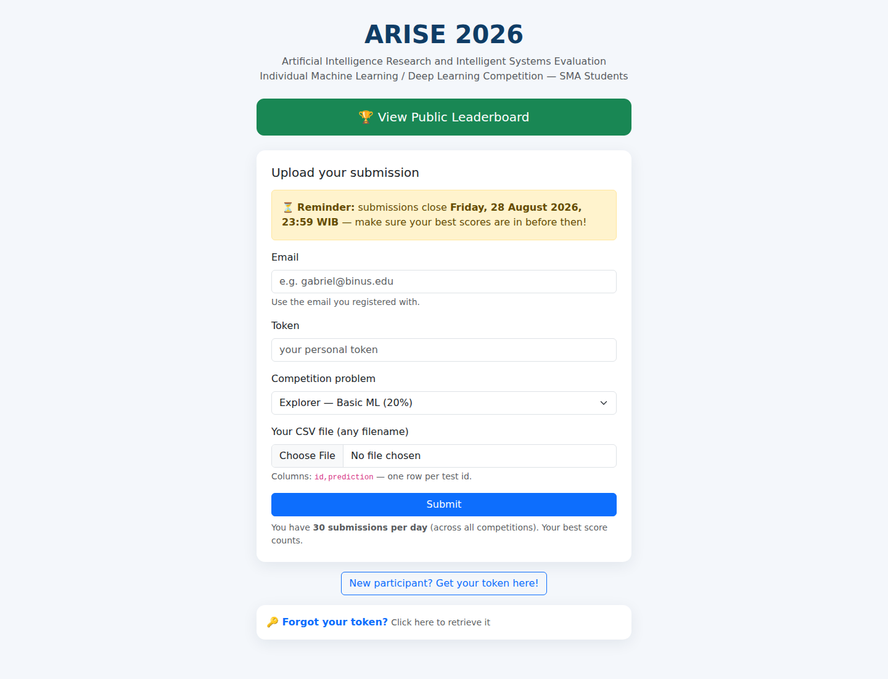
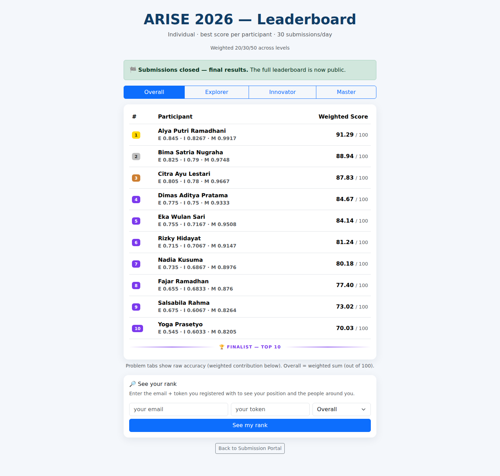
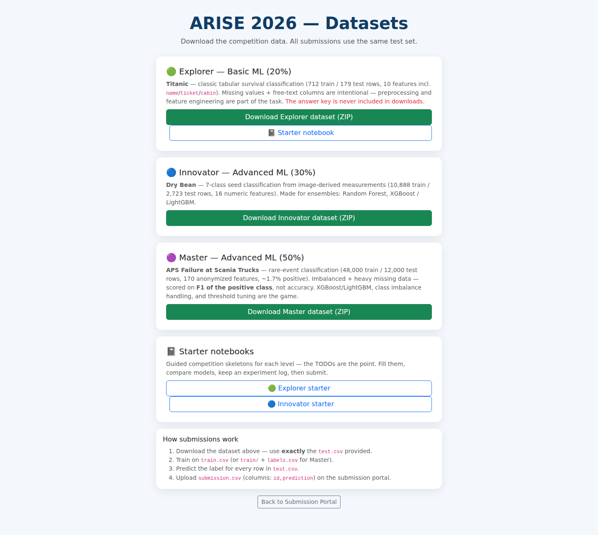

# ARISE — Competition Submission Platform

A self-hosted, Kaggle-style machine learning competition platform. Built for **ARISE**, a national ML competition for Indonesian high-school students, and run on a single small VPS.

Participants register, download a private train/test split, submit a CSV of predictions, and get a score and leaderboard position immediately. Every submission is archived, every dataset download is checksum-verifiable, and all three difficulty tracks are scored by one evaluation pipeline.

This repository is a **sanitized archival snapshot** of the platform as it ran in 2026.

## What it looks like







Captured from this codebase running locally on generated demo data, with ten fictional participants (`@example.com`) and synthetic datasets. No real participant data appears in these images.

## What is included, and what is not

| Included | Excluded on purpose |
|---|---|
| FastAPI backend (routes, validation, scoring) | Competition datasets (`train.csv`, `test.csv`) — regenerate with the setup scripts |
| Frontend pages served by the app | Answer keys (`answer.csv`) — never leave the server |
| Setup, backup, and admin scripts | Participant database and submissions |
| Starter notebooks handed to students | Server credentials, admin key, deployment paths |
| | Virtualenv |

Nothing in this repository identifies a participant. The admin key is read from an environment variable and has no default, so a fresh clone of this code cannot open admin routes until a key is set.

## Architecture

```
.
├── backend/
│   ├── main.py        FastAPI app and all routes
│   ├── config.py      paths, limits, per-track problem definitions
│   ├── database.py    SQLAlchemy engine and session
│   ├── models.py      Participant, Submission
│   ├── validator.py   CSV validation rules
│   └── evaluator.py   scoring engine (accuracy / macro-F1 / positive-class F1 / RMSE)
├── frontend/
│   ├── index.html         submission portal
│   ├── register.html      registration and token recovery
│   ├── leaderboard.html   public leaderboard
│   ├── admin.html         admin console
│   ├── datasets.html      dataset downloads + manifest checksums
│   └── notebooks/         starter notebooks (guided skeletons)
└── scripts/
    ├── setup_titanic_explorer.py     builds the Explorer track
    ├── setup_drybean_innovator.py    builds the Innovator track
    ├── setup_scania_master.py        builds the Master track
    ├── build_starter_notebooks.py    regenerates the student notebooks
    ├── backup.py                     dated SQLite + artifacts snapshot
    ├── admin_report.py               submission log report
    └── seed_participants.py          bulk registration for demos
```

Single SQLite database, single process, one systemd unit behind a tunnel. There is no queue, no cache, no container. The whole thing ran on a $5/month VPS.

## The three tracks

Three problems with increasing difficulty, weighted into one overall score.

- **Explorer (20%)** — Titanic, 10 features, plain accuracy. Deliberately dirty: missing values are left in place so preprocessing is part of the lesson.
- **Innovator (30%)** — Dry Bean, 16 features, 7 classes, accuracy. Labels are strings, not integers, to match what a participant sees in the file.
- **Master (50%)** — Scania APS truck failures, 170 anonymised features, 1.7% positive rate. Scored by **F1 of the positive class**, not accuracy: predicting "no failure" for every row scores 98% accuracy and catches nothing.

Every track ships `train.csv`, `test.csv`, `sample_submission.csv` and a secret `answer.csv`. The sample submission is deliberately dumb (majority class), so a participant who submits it unchanged learns what a baseline actually scores.

## Scoring rules worth knowing

- **One attempt counts, many are allowed.** Up to 30 accepted submissions per participant per day across all tracks. Only the best score per track is ranked.
- **Ties break by time.** Identical scores rank by the timestamp at which each participant first achieved that score, so the earlier submission wins.
- **Validation before scoring.** Column names, duplicate ids, missing values, row count, and exact id-set equality with `test.csv` are all checked. On failure the reason is human-readable, not a stack trace.
- **Label types are reconciled.** A student who submits `0/1` for a string-labelled problem is mapped to the sorted class order rather than getting a 500.
- **Byte-level dataset verification.** Each dataset download exposes a per-file SHA-256 manifest, so a participant can prove their local copy matches the split everyone else trained on.

## Running it

```bash
python -m venv venv && source venv/bin/activate
pip install -r requirements.txt

export ARISE_HOME="$PWD"          # deployment root; defaults to the repo root
export ARISE_ADMIN_KEY="$(python -c 'import secrets; print(secrets.token_hex(24))')"

python scripts/setup_titanic_explorer.py     # downloads public data, writes splits
python scripts/setup_drybean_innovator.py
python scripts/setup_scania_master.py
python scripts/build_starter_notebooks.py

cd backend && uvicorn main:app --port 8000
```

Open `http://localhost:8000/` to submit, `/leaderboard.html` for the board, `/datasets` for downloads.

The setup scripts fetch their datasets from public sources (Titanic, UCI Dry Bean, UCI Scania APS), so the repository stays small and no answer key is ever committed.

## Design notes

**Why a single evaluator with per-problem metrics instead of three apps.** The three tracks differ only in data, metric, and weight. Keeping them in one `PROBLEMS` dict meant a rules change — a new submission cap, a tie-break fix, an id-validation tweak — reached every track at once.

**Why positive-class F1 for the hard track.** An imbalanced competition scored by accuracy teaches the wrong lesson: the top of the leaderboard fills with people who predicted nothing. F1 forces a real model.

**Why submissions are archived rather than counted.** Every uploaded file is kept with its participant and timestamp. When the final score is 15% leaderboard and 85% human-judged presentation and technical Q&A, the submission history is evidence, and a score alone is not.

**What this platform cannot do.** It grades a CSV. It cannot tell you whether a student understands why their model works, and a high leaderboard position is not the same as a good methodology. The human-judged portion exists because a competition that stops at the leaderboard would be measuring the wrong thing.

## Context

ARISE was organised for Indonesian high-school students. The platform was built and operated solo alongside teaching responsibilities, and the three tracks were designed so that a student with a laptop and no GPU could compete meaningfully on the first two.
